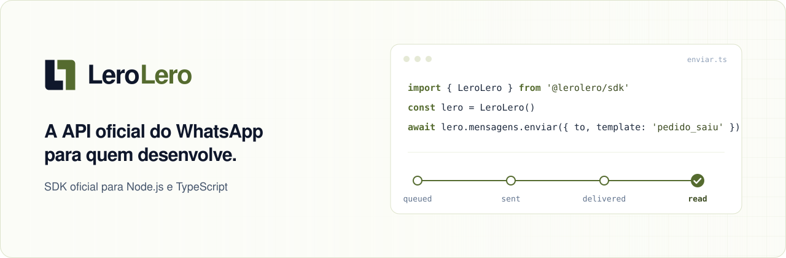

<p align="center">
  <a href="https://lerolero.tech">
    <picture>
      <source media="(prefers-color-scheme: dark)" srcset="./assets/banner-escuro.svg">
      <source media="(prefers-color-scheme: light)" srcset="./assets/banner-claro.svg">
      
    </picture>
  </a>
</p>

<p align="center">
  <a href="https://www.npmjs.com/package/@lerolero/sdk"></a>
  <a href="https://github.com/Olvies-Tech/lerolero-node/actions/workflows/ci.yml"></a>
  <a href="./LICENSE"></a>
  
  
  
</p>

<p align="center">
  <a href="https://lerolero.tech/docs"><b>Documentação</b></a>
  &nbsp;&nbsp;
  <a href="https://lerolero.tech/docs/referencia/api">Referência da API</a>
  &nbsp;&nbsp;
  <a href="https://lerolero.tech/criar-conta">Criar conta</a>
</p>

<br>

O SDK oficial do **LeroLero**, a API oficial do WhatsApp (Cloud API da Meta) para sistemas. Lembretes, confirmações,
códigos e boletos saem do seu sistema para o WhatsApp do seu cliente em poucas linhas, com tipos em cada campo e sem
surpresa em produção.

```ts
import { LeroLero } from '@lerolero/sdk'

const lero = LeroLero({ chave: process.env.LERO_API_KEY })
const envio = await lero.mensagens.enviar({ to: '+5511993185520', template: 'pedido_saiu' })
```

## Por que usar

- **Tipado de ponta a ponta.** Cada envio, mensagem, template e evento de webhook tem tipo, com JSDoc em português. O
  editor completa o campo, avisa o que falta e mostra o que cada código de erro quer dizer.
- **Nunca lança exceção.** Todo método devolve `{ sucesso, dados, erro }`. Erro de validação, queda de rede e tempo
  esgotado chegam do mesmo jeito, com uma categoria para você decidir o que fazer.
- **Retentativa e idempotência prontas.** O envio de mensagem leva `Idempotency-Key` sozinho e repete com segurança
  quando a rede falha: o contato recebe uma vez só.
- **Webhook verificado em uma linha.** `lero.webhooks.verificar(corpo, cabecalhos)` confere a assinatura e devolve o
  evento com o tipo certo para o `switch`.
- **Teste ou produção pela chave.** `lero_test_` usa o Simulador e não envia nada de verdade; `lero_live_` envia. Nenhuma
  configuração a mais.

## Instalação

```bash
npm install @lerolero/sdk
pnpm add @lerolero/sdk
yarn add @lerolero/sdk
bun add @lerolero/sdk
```

Só o `@lerolero/sdk`: os tipos e o cliente HTTP vêm junto. Funciona em Node.js 18 ou mais novo, com `import` ou com
`require`.

<table>
<tr>
<th align="left" width="50%">TypeScript ou JavaScript com <code>import</code></th>
<th align="left" width="50%">JavaScript com <code>require</code> (CommonJS)</th>
</tr>
<tr>
<td valign="top">

```ts
import { LeroLero } from '@lerolero/sdk'

const lero = LeroLero()
```

</td>
<td valign="top">

```js
const { LeroLero } = require('@lerolero/sdk')

const lero = LeroLero()
```

</td>
</tr>
</table>

Os tipos vêm no pacote, para os dois jeitos: no JavaScript puro, o VS Code também completa os campos e mostra a
documentação de cada método.

## Primeiro envio em 30 segundos

1. Crie a conta em [lerolero.tech/criar-conta](https://lerolero.tech/criar-conta) e crie uma chave de teste no painel,
   em **Desenvolvedor > Chaves de API**.
2. Guarde a chave na variável de ambiente `LERO_API_KEY`. O SDK lê dela quando você não passa `chave`.
3. Envie:

```ts
import { LeroLero } from '@lerolero/sdk'

const lero = LeroLero()
const resultado = await lero.mensagens.enviar({ to: '+5511993185520', template: 'boas_vindas' })

if (resultado.sucesso) console.log(resultado.dados) // { id: 'msg_4kd8s2m9x7q3w5e1r6t2y8u4', status: 'queued' }
```

A mensagem entra na fila e segue de `queued` para `sent`, `delivered` e `read`. Acompanhe com
`lero.mensagens.obter(id)` ou receba cada passo no seu webhook.

## Exemplos

<details>
<summary><b>Template com variáveis e botões de resposta</b></summary>

<br>

As variáveis vão pelo nome (`{{nome}}` vira `nome`). O `metadata` volta em todo evento da mensagem, então você liga a
resposta ao agendamento do seu sistema sem guardar nada a mais.

```ts
import { LeroLero } from '@lerolero/sdk'

const lero = LeroLero()

await lero.mensagens.enviar({
  to: '+5511993185520',
  template: 'confirmacao_agendamento',
  variaveis: { nome: 'Ana', servico: 'Limpeza', data: '24/10', hora: '14h' },
  botoes: [{ payload: 'CONFIRMAR:123' }, { payload: 'CANCELAR:123' }],
  metadata: { agendamentoId: '123' },
})
```

</details>

<details>
<summary><b>Texto livre dentro da janela de 24 horas</b></summary>

<br>

Depois que o contato escreve, a janela de 24 horas abre e você pode responder sem template.

```ts
import { LeroLero } from '@lerolero/sdk'

const lero = LeroLero()

await lero.mensagens.enviar({ to: '+5511993185520', texto: 'Seu pedido saiu para entrega e chega até as 18h.' })
```

</details>

<details>
<summary><b>Boleto em PDF: subir a mídia e enviar</b></summary>

<br>

```ts
import { readFile } from 'node:fs/promises'
import { LeroLero } from '@lerolero/sdk'

const lero = LeroLero()

const midia = await lero.midias.subir({
  conteudo: await readFile('boleto-novembro.pdf'),
  nome: 'boleto-novembro.pdf',
  tipo: 'application/pdf',
})

if (midia.sucesso) {
  await lero.mensagens.enviar({
    to: '+5511993185520',
    template: 'boleto_disponivel',
    variaveis: { nome: 'Ana', vencimento: '10/12' },
    documento: { mediaId: midia.dados.id, nome: 'boleto-novembro.pdf' },
  })
}
```

O mesmo arquivo enviado de novo devolve a mesma mídia: dá para subir em todo envio sem acumular cópias.

</details>

<details>
<summary><b>Botões de resposta numa conversa aberta</b></summary>

<br>

```ts
import { LeroLero } from '@lerolero/sdk'

const lero = LeroLero()

await lero.mensagens.enviar({
  to: '+5511993185520',
  interativo: {
    texto: 'Podemos confirmar a sua consulta de amanhã às 14h?',
    botoes: [
      { id: 'confirmar', titulo: 'Confirmar' },
      { id: 'remarcar', titulo: 'Remarcar' },
    ],
  },
})
```

</details>

<details>
<summary><b>Mensagem agendada (e cancelada)</b></summary>

<br>

```ts
import { LeroLero } from '@lerolero/sdk'

const lero = LeroLero()

const agendada = await lero.mensagens.enviar({
  to: '+5511993185520',
  template: 'lembrete_consulta',
  variaveis: { nome: 'Ana', hora: '14h' },
  agendarPara: '2026-11-20T09:00:00-03:00',
})

if (agendada.sucesso) await lero.mensagens.cancelar(agendada.dados.id)
```

Enquanto está na fila, a mensagem pode ser cancelada e não gera custo.

</details>

<details>
<summary><b>Conferir a janela antes de enviar</b></summary>

<br>

```ts
import { LeroLero } from '@lerolero/sdk'

const lero = LeroLero()
const to = '+5511993185520'

const consulta = await lero.conversas.janela({ telefones: [to] })
const aberta = consulta.sucesso && consulta.dados.telefones[0]?.aberta

await lero.mensagens.enviar(
  aberta ? { to, texto: 'Seu pedido saiu para entrega.' } : { to, template: 'pedido_saiu', variaveis: { nome: 'Ana' } },
)
```

</details>

<details>
<summary><b>Opt-out: o contato pediu para sair</b></summary>

<br>

```ts
import { LeroLero } from '@lerolero/sdk'

const lero = LeroLero()

await lero.optOuts.adicionar({ telefone: '+5511984213307', motivo: 'Pediu por e-mail' })

// Se ele pedir para voltar pelo seu canal:
await lero.optOuts.remover('+5511984213307')
```

</details>

<details>
<summary><b>Revenda: um cliente por empresa atendida</b></summary>

<br>

Na revenda, cada empresa que você atende é um cliente, com número e templates próprios. O `idExterno` é o seu id para
ele e vale no lugar do `cli_...` em todo método.

```ts
import { LeroLero } from '@lerolero/sdk'

const lero = LeroLero()

await lero.clientes.criar({ nome: 'Clínica Sorriso', idExterno: 'clinica-sorriso', documento: '12345678000190' })

await lero.mensagens.enviar({
  cliente: 'clinica-sorriso',
  to: '+5511993185520',
  template: 'confirmacao_agendamento',
  variaveis: { nome: 'Ana', servico: 'Limpeza', data: '24/10', hora: '14h' },
})
```

</details>

## Webhooks

O LeroLero avisa o seu sistema quando a mensagem muda de status, o contato toca num botão, escreve ou sai da lista. Cada
entrega vem assinada: verifique antes de processar. Passe o **corpo cru**, antes do `JSON.parse`, porque a assinatura é
do texto exato.

<details open>
<summary><b>Express</b></summary>

<br>

```ts
import express from 'express'
import { LeroLero } from '@lerolero/sdk'

const lero = LeroLero({ segredoDoWebhook: process.env.LERO_WEBHOOK_SECRET })
const app = express()

app.post('/webhooks/lero', express.raw({ type: 'application/json' }), (req, res) => {
  const verificacao = lero.webhooks.verificar(req.body, req.headers)
  if (!verificacao.sucesso) return res.status(400).send(verificacao.erro.description)

  const evento = verificacao.dados
  switch (evento.evento) {
    case 'message.status_updated':
      atualizarStatus(evento.mensagem.id, evento.mensagem.status)
      break
    case 'message.button_reply':
      registrarResposta(evento.mensagemOriginal.metadata, evento.resposta.payload)
      break
    case 'contact.opted_out':
      tirarDaLista(evento.contato.telefone)
      break
  }
  return res.sendStatus(200)
})
```

</details>

<details>
<summary><b>Next.js (route handler)</b></summary>

<br>

```ts
// app/api/webhooks/lero/route.ts
import { verificarWebhook } from '@lerolero/sdk'

export async function POST(requisicao: Request) {
  const verificacao = verificarWebhook({
    corpo: await requisicao.text(),
    cabecalhos: requisicao.headers,
    segredo: process.env.LERO_WEBHOOK_SECRET ?? '',
  })
  if (!verificacao.sucesso) return new Response(verificacao.erro.description, { status: 400 })

  const evento = verificacao.dados
  if (evento.evento === 'message.button_reply') {
    registrarResposta(evento.mensagemOriginal.metadata, evento.resposta.payload)
  }
  return new Response(null, { status: 200 })
}
```

</details>

A assinatura é `sha256=` + HMAC-SHA256 de `{timestamp}.{corpo}` com o segredo do endpoint, e o timestamp mais velho que
5 minutos é recusado. O segredo aparece uma única vez, na resposta de `lero.webhooks.criar`: guarde no seu cofre. O
[vetor de teste](./vetores/assinatura-do-webhook.json) é o mesmo do SDK C# e da documentação.

**Processe cada entrega uma vez só.** Dentro da janela de 5 minutos, a mesma entrega assinada passa de novo na
verificação: o LeroLero reenvia quando o seu servidor não responde 2xx, e quem capturou a requisição pode repeti-la.
Deduplique pelo `entregaId`, que está no corpo assinado e é o mesmo em todas as tentativas da entrega. O cabeçalho
`X-Lero-Event-Id` traz o mesmo valor, mas **não é coberto pela assinatura**: não use o cabeçalho para deduplicar.

```ts
import { LeroLero } from '@lerolero/sdk'

const lero = LeroLero({ segredoDoWebhook: process.env.LERO_WEBHOOK_SECRET })
const jaProcessadas = new Set<string>() // em produção, uma tabela com índice único no entregaId

export function receber(corpoCru: Buffer, cabecalhos: Record<string, string | string[] | undefined>): number {
  const verificacao = lero.webhooks.verificar(corpoCru, cabecalhos)
  if (!verificacao.sucesso) return 400

  const { entregaId } = verificacao.dados
  if (jaProcessadas.has(entregaId)) return 200
  jaProcessadas.add(entregaId)

  // processe verificacao.dados aqui
  return 200
}
```

## Teste e produção

| Chave        | Ambiente | O que acontece                                                              |
| ------------ | -------- | --------------------------------------------------------------------------- |
| `lero_test_` | Teste    | Vai para o Simulador: nada sai para o WhatsApp de ninguém e nada é cobrado. |
| `lero_live_` | Produção | Sai pela Meta, para o WhatsApp do contato, e conta no seu plano.            |

O código é o mesmo nos dois: só a chave muda. Use a de teste no desenvolvimento e nos testes automatizados, e a de
produção só no servidor de produção. `lero.ambiente` diz qual está em uso.

## Erros

Nenhum método lança exceção. O retorno é sempre um destes dois:

```ts
import type { RespostaDaApi } from '@lerolero/sdk'

export type Retorno<T> = RespostaDaApi<T>
// { sucesso: true,  dados: T,    erro: null,          detalhes }
// { sucesso: false, dados: null, erro: ErroDaChamada, detalhes }
```

O erro da API traz o código `EX` (`code`), a frase pronta para mostrar (`description`), o campo que causou (`field`) e,
do catálogo do SDK, a família e o que fazer (`comoResolver`). Os códigos têm nome em `Erros`, para comparar sem decorar
número.

```ts
import { Erros, LeroLero, ehErro } from '@lerolero/sdk'

const lero = LeroLero()
const to = '+5511993185520'

const resultado = await lero.mensagens.enviar({ to, texto: 'Seu pedido saiu para entrega.' })

if (ehErro(resultado, Erros.Mensagens.JanelaFechada)) {
  await lero.mensagens.enviar({ to, template: 'pedido_saiu', variaveis: { nome: 'Ana' } })
} else if (ehErro(resultado, Erros.Mensagens.IdempotenciaConflitante)) {
  console.error(resultado.erro.comoResolver) // Gerar uma chave nova para cada envio diferente
} else if (!resultado.sucesso) {
  console.error(resultado.erro.categoria, resultado.erro.description)
}
```

| Categoria        | Quando                                                                                 |
| ---------------- | -------------------------------------------------------------------------------------- |
| `validacao`      | Algum dado está errado. Corrija antes de reenviar (`field` diz qual).                   |
| `autenticacao`   | Chave ausente, errada, expirada ou revogada.                                           |
| `permissao`      | A chave não pode fazer isso, ou o contato não aceita (opt-out, marketing sem aceite).   |
| `nao_encontrado` | Mensagem, template, mídia ou cliente que não existe.                                    |
| `conflito`       | A operação já foi feita ou não cabe agora.                                              |
| `limite`         | Muitas requisições ou limite de mensagens atingido.                                     |
| `indisponivel`   | A API ou a Meta está fora do ar. O SDK já repetiu quando era seguro.                     |
| `inesperado`     | Erro interno. A `description` traz o código de correlação para o suporte.               |
| `rede`           | A requisição não chegou à API.                                                          |
| `timeout`        | A API não respondeu a tempo. `possivelmenteProcessada` diz se o pedido pode ter saído.   |
| `configuracao`   | O SDK recusou antes de chamar a API: chave fora do formato, `urlBase` sem https, id vazio, `.` ou `..`, opção inválida. |
| `resposta_grande` | A resposta passou de `limiteDaRespostaBytes` (padrão 10 MB) e não foi lida.            |

`ehDaFamilia(resultado, 'EXMT')` reconhece uma família inteira (aqui, os erros que vêm da Meta). Os 81 códigos, com o
significado e o que fazer, estão em [lerolero.tech/docs/referencia/erros](https://lerolero.tech/docs/referencia/erros)
e no `CATALOGO_DE_ERROS` do SDK.

## Retentativa e idempotência

O SDK repete sozinho quando é seguro, com espera crescente e um pouco de variação aleatória, e respeita o `Retry-After`
da API.

| Requisição                                  | Repete em                                               |
| ------------------------------------------- | ------------------------------------------------------- |
| Consulta (`GET`)                            | 408, 425, 429, 500, 502, 503, 504, rede e timeout       |
| Envio de mensagem (com `Idempotency-Key`)   | 408, 425, 429, 500, 502, 503, 504, rede e timeout       |
| Os outros `POST`, `PUT`, `PATCH` e `DELETE` | Só 429, que a API devolve antes de fazer qualquer coisa |

**Por que repetir um envio é seguro:** toda chamada de `mensagens.enviar` leva uma `Idempotency-Key`, a mesma em todas
as tentativas. Com ela, a API não envia duas vezes: devolve a mensagem do primeiro pedido. Se o tempo esgotar de vez, a
chave usada vem em `detalhes.chaveDeIdempotencia`. Reenvie com ela e o contato continua recebendo uma vez só.

```ts
import { LeroLero } from '@lerolero/sdk'

const lero = LeroLero()
const envio = { to: '+5511993185520', template: 'pedido_saiu' } as const

const primeira = await lero.mensagens.enviar(envio, { chaveDeIdempotencia: 'pedido-8812-saiu' })
if (primeira.erro?.categoria === 'timeout') {
  const segunda = await lero.mensagens.enviar(envio, { chaveDeIdempotencia: 'pedido-8812-saiu' })
  console.log(segunda.detalhes.repetida) // true quando a primeira já tinha saído
}
```

Para mudar o padrão: `LeroLero({ tempoLimiteMs: 10_000, retentativa: { maximo: 5 } })`, ou as mesmas opções numa
chamada do `lero.rest`. Valor que não faz sentido (`maximo: -1`, `esperaMaximaMs: NaN`, `tempoLimiteMs: 0`) não vira o
padrão em silêncio: a chamada falha como `configuracao`, sem ir à API.

**Idempotência fora do envio de mensagem:** hoje a API só deduplica pela `Idempotency-Key` no `POST /v1/messages`, que o
`mensagens.enviar` já usa. O `lero.rest` aceita `{ idempotencia: {} }` em qualquer rota, e aí também repete em 5xx e
timeout, mas em outra rota a API pode fazer o pedido duas vezes. Peça a idempotência só onde repetir for seguro para
você.

## O que a v1 cobre

| Recurso          | Métodos                                   | Rotas                  |
| ---------------- | ----------------------------------------- | ---------------------- |
| `lero.mensagens` | `enviar`, `obter`, `cancelar`             | `/v1/messages`         |
| `lero.midias`    | `subir`, `obter`                          | `/v1/media`            |
| `lero.templates` | `criar`, `listar`, `obter`                | `/v1/templates`        |
| `lero.conversas` | `janela`                                  | `/v1/conversas/janela` |
| `lero.optOuts`   | `adicionar`, `remover`                    | `/v1/opt-outs`         |
| `lero.clientes`  | `criar`, `listar`, `obter`                | `/v1/clientes`         |
| `lero.webhooks`  | `criar`, `listar`, `remover`, `verificar` | `/v1/webhooks`         |

Qualquer outra rota da API, com a mesma chave, retentativa e resultado sem exceção, pelo `lero.rest`:

```ts
import { LeroLero, type Pagina } from '@lerolero/sdk'

interface Contato {
  telefone: string
  nome: string | null
}

const lero = LeroLero()
const contatos = await lero.rest.get<Pagina<Contato>>('/contatos', { consulta: { limite: 20 } })

if (contatos.sucesso) console.log(`${contatos.dados.total} contatos`)
```

`lero.rest` tem `get`, `post`, `put`, `patch` e `delete`. Os caminhos são da versão da API: `/contatos` é
`/v1/contatos`.

## Os três pacotes

| Pacote                                | Para quem                                                                       |
| ------------------------------------- | ------------------------------------------------------------------------------- |
| [`@lerolero/sdk`](./packages/sdk)     | Quem integra: os métodos por recurso, a verificação de webhook e o `lero.rest`. |
| [`@lerolero/rest`](./packages/rest)   | Quem quer só o cliente HTTP: chave, retentativa, idempotência e resultado.      |
| [`@lerolero/types`](./packages/types) | Quem só precisa dos tipos da API e do catálogo de erros.                        |

Os três saem em ESM e CommonJS, com `sideEffects: false` e sem nenhuma dependência de terceiros.

## Links

- Documentação: [lerolero.tech/docs](https://lerolero.tech/docs)
- Referência da API: [lerolero.tech/docs/referencia/api](https://lerolero.tech/docs/referencia/api)
- Códigos de erro: [lerolero.tech/docs/referencia/erros](https://lerolero.tech/docs/referencia/erros)
- Criar conta: [lerolero.tech/criar-conta](https://lerolero.tech/criar-conta)
- Suporte para desenvolvedores: [desenvolvimento@lerolero.tech](mailto:desenvolvimento@lerolero.tech)

Para quem mantém o SDK: o passo a passo de uma versão no npm está em [docs/publicar.md](./docs/publicar.md).

## Licença

[Apache-2.0](./LICENSE). Feito pela [OliveS Tech](https://github.com/Olvies-Tech).
